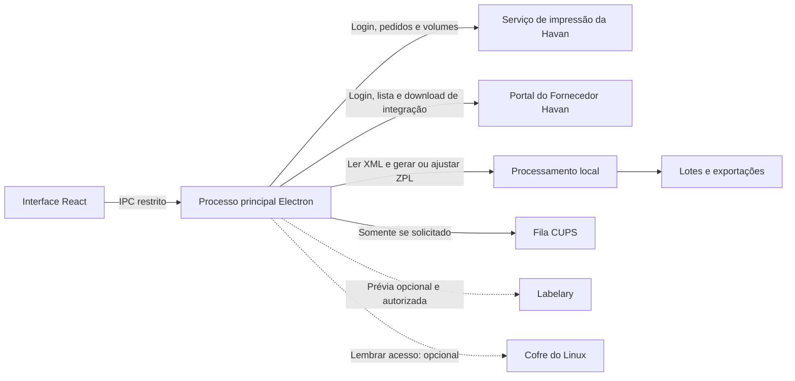

<div align="center">


# Vinqueta

**Do pedido à impressão, em um só aplicativo.**

Aplicativo desktop independente para fornecedores da Havan gerarem, conferirem e imprimirem etiquetas de **volume** e **preço**.


[](LICENSE)

[Fluxo de uso](#fluxo-de-uso) · [Instalação](#instalação) · [Desenvolvimento](#desenvolvimento) · [Segurança](SECURITY.md)

</div>

> **Estado atual:** versão 0.6.1, com build e instalação local no Linux.

## Por que este projeto existe?

O projeto nasceu de uma rotina de fornecedor: as etiquetas de volume exigiam um ajuste manual no ZPL para encaixar no papel usado na operação, e as de preço dependiam de uma segunda ferramenta, embora o XML de integração já trouxesse os dados necessários. Era fácil perder tempo alternando entre programas ou precisar gerar de novo algo que já estava pronto.

A Vinqueta reúne essas tarefas. Ajusta a posição das etiquetas de volume sem alterar seus identificadores, prepara etiquetas de preço diretamente a partir do XML e mantém os lotes no computador para exportar ou imprimir novamente, sem solicitar novos códigos à Havan.

## Fluxo de uso

1. **Entre uma vez.** Use o CNPJ e a senha do portal da Havan no painel inicial. A navegação só aparece após a autenticação, e **Pedidos** abre com a consulta do ano atual. No Linux, **Lembrar acesso neste computador** é opcional.
2. **Escolha o que preparar.** Em **Pedidos**, selecione os itens e solicite os volumes. Em **Etiquetas de preço**, consulte a integração no portal, importe um XML/RAR/ZIP existente ou preencha os dados manualmente.
3. **Confira e gere.** Nos preços, revise EAN, preço de venda e quantidade antes de gerar. Nos volumes, a Central preserva o original e aplica o ajuste. Nada é impresso só por gerar ou baixar a integração.
4. **Exporte ou imprima.** Abra o lote para inspecionar o ZPL, exportar **TXT/ZIP** ou enviar a uma fila compatível. Lotes já salvos não precisam ser consultados novamente na Havan.

Em **Configurações**, escolha tema claro, escuro ou do sistema e restaure os avisos de confirmação. O tema não muda as etiquetas.

### Atualizações

Depois do login, o topo consulta as releases estáveis de [`kelvinmattosdev/vinqueta`](https://github.com/kelvinmattosdev/vinqueta/releases).
**Atualizar para…** abre a release no navegador; a instalação é manual. Se não for possível verificar, a Vinqueta não afirma que está atualizada.
Ao abrir uma versão nova, o histórico reúne as notas das versões intermediárias conhecidas, incluindo correções de segurança quando publicadas.
O modal volta apenas após outra atualização quando a leitura é confirmada. Em uma instalação sem histórico anterior, a versão em uso é o ponto de partida.

Para manter o histórico disponível sem internet, adicione cada versão estável ao [`CHANGELOG.md`](CHANGELOG.md) antes de empacotar e publique a release com a tag `vMAJOR.MINOR.PATCH`.

## Instalação

| Plataforma | Situação |
|---|---|
| **Linux** | Build local disponível: `.deb` e AppImage para x86-64. |
| **Windows** | Planejado. Sem instalador validado. |
| **macOS** | Planejado. Sem instalador validado. |

Não há link público de download nesta etapa. No Linux, a partir do código-fonte:

```bash
npm ci
npm run install:local   # instala para o usuário atual e registra o atalho, sem sudo
npm run dist:linux      # alternativa: gera .deb e AppImage em release/
```

O build do ícone usa Chrome (`CHROME_PATH` aponta para outro executável compatível). A versão empacotada não exige Node.js nem terminal para abrir. A operação online exige uma conta de fornecedor habilitada e um arquivo privado de compatibilidade (`protocol.json`), **não incluído no código nem nos pacotes**. Use **Importar configuração local** no painel de acesso se a instalação ainda não estiver configurada. A distribuição desse pré-requisito precisa ser resolvida antes de oferecer um download público funcional.

## Arquitetura

**React + TypeScript** para a interface, **Electron** para autenticação, arquivos e impressão, e módulos locais para ler integrações e processar ZPL. A interface acessa somente as operações expostas pelo preload.



| Pasta | Responsabilidade |
|---|---|
| [`src/`](src/) | Login, pedidos, editor de preço, histórico e configurações. |
| [`electron/`](electron/) | IPC, clientes da Havan, cofre, integração de arquivos, lotes e impressão. |
| [`shared/`](shared/) | Validação, geração de preços e ajuste de volumes em ZPL. |
| [`tests/`](tests/) e [`scripts/`](scripts/) | Testes, verificações da interface e empacotamento. |
| [`docs/`](docs/) | Documentação complementar e diagramas. |

### Integrações

| Serviço | O que faz |
|---|---|
| **Havan** | Os clientes acessam por HTTPS o serviço usado pelo aplicativo oficial de etiquetas e o Portal do Fornecedor. Não há servidor intermediário do projeto. Os contratos de integração usados aqui não são apresentados como APIs públicas ou documentadas pela Havan. |
| **Labelary** | Prévia PNG opcional. Recebe uma fileira do ZPL de preço, com EAN e preço, somente mediante ação explícita. Não recebe senha, cookies da Havan nem o XML completo. |
| **CUPS e cofre do Linux** | CUPS recebe o ZPL para impressão; o cofre Secret Service armazena o acesso somente quando o usuário opta por lembrar. |

Não há API pública própria. A integração entre interface e processo principal está definida em [`electron/preload.cjs`](electron/preload.cjs) e [`src/types.ts`](src/types.ts). Consulte [Segurança e privacidade](SECURITY.md) para saber o que é salvo ou enviado.

## Desenvolvimento

```bash
npm ci
npm run desktop         # abre o app Electron
npm run check           # testes, verificação TypeScript e build
npm run test:desktop    # fluxo real no Electron com serviços simulados
```

`npm run dev -- --port 5174` serve a interface para desenvolvimento visual. Nesse modo, o navegador não tem os serviços do Electron. Para verificar os temas e o layout, use `npm run test:theme` e `VINQUETA_UI_URL=http://127.0.0.1:5174 npm run test:ui` com o servidor rodando.

## Limites atuais

- **Volume:** o ajuste histórico desloca posições em **−30 dots** a partir da linha de referência, preservando os dados da etiqueta. Não converte DPI nem substitui a gravação de RFID.
- **Preço:** perfil atual de **33 × 22 mm**, três colunas, EAN em texto e sem parcelas. A integração usa `PrecoVenda`, não custo do fornecedor. Os exemplos da interface são fictícios.
- **Impressão:** requer fila CUPS compatível com ZPL bruto. Enviar à fila não confirma a impressão física. Confira calibração e resolução com um lote de teste.
- **Publicação:** antes da primeira release, resolver o arquivo privado de compatibilidade e validar instaladores, impressão e armazenamento seguro por plataforma.

## Documentação adicional

- [Segurança, privacidade e reporte de vulnerabilidades](SECURITY.md)
- [Histórico de versões](CHANGELOG.md)
- [Temas e verificação de contraste](docs/theme.md)
- [Fluxograma editável — referência histórica](docs/fluxo-atual.drawio) (diagrams.net)
- [Licença MIT](LICENSE)

Desenvolvido por **[Kelvin Mattos](https://github.com/kelvinmattosdev)**. Projeto independente, sem afiliação ou endosso da Havan. A licença MIT cobre o código próprio; nomes, marcas, serviços e componentes de terceiros mantêm suas respectivas condições.
